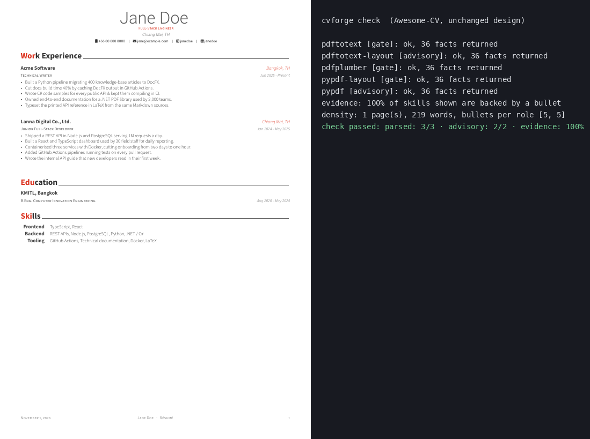

# CV Forge

[](https://github.com/FadelJD/Help-me-resume/actions/workflows/ci.yml)
[](https://github.com/FadelJD/Help-me-resume/actions/workflows/install-test.yml)


CV Forge builds your CV from one plain-text file and a LaTeX template you choose. Then it reads the PDF back the way hiring software does and tells you which facts came through.


## Why

Many employers run every CV through screening software before a person reads it. That software pulls the text out of your PDF, and LaTeX CVs often come out scrambled: dates go missing, two columns merge into one, an icon sticks to your phone number. CV Forge keeps every fact about you in one file, builds the CV from it, and checks the result with the same free PDF readers that screening tools use.

## Install

Every block ends with `cvforge doctor`. It checks Python, LaTeX and the PDF readers, and prints the install command for anything missing. pipx, used below, installs command-line apps written in Python.

### Windows

In PowerShell:

```powershell
winget install -e --id Python.Python.3.12
winget install -e --id Git.Git
winget install -e --id MiKTeX.MiKTeX
py -m pip install --user pipx
py -m pipx ensurepath
# Close and reopen PowerShell so the new PATH applies, then:
py -m pipx install "cvforge[check] @ git+https://github.com/FadelJD/Help-me-resume"
cvforge doctor
```

Windows support is new. [docs/windows.md](docs/windows.md) covers TeX Live as an alternative to MiKTeX, which PDF readers run on Windows, and what has been tested there.

### Ubuntu or Debian

```bash
sudo apt-get update && sudo apt-get install -y latexmk texlive-latex-extra texlive-fonts-recommended lmodern poppler-utils pipx
pipx install "cvforge[check] @ git+https://github.com/FadelJD/Help-me-resume"
cvforge doctor
```

### WSL

WSL runs Ubuntu inside Windows. Open its Ubuntu terminal and follow the Ubuntu block above.

### macOS

Install [MacTeX](https://tug.org/mactex/), poppler and pipx with Homebrew, then run the last two lines of the Ubuntu block. CI does not test macOS yet.

If a terminal says `cvforge: command not found`, run `pipx ensurepath` and open a new terminal.

## Quick start

The same commands work in bash and PowerShell:

```bash
mkdir my-cv
cd my-cv
cvforge init --example
cvforge build --compile -o out/cv.tex
cvforge check out/cv.tex
```

This builds a CV for Jane Doe, a fictional person, and leaves two files in `out`: the PDF, `cv.pdf`, and the check results, `cv.report.json`. To start your own, run `cvforge init` in an empty folder and answer its questions.

## What the check does

`cvforge check` reads your PDF with up to seven PDF readers and reports three things.

- **Read back:** each reader turns the PDF into plain text, and CV Forge looks for your name and contact details, every title, employer and date, the start of every bullet, and every skill. Three readers must return all of them for the check to pass, and the others are shown for information.
- **Job match:** with `--job ad.txt`, it reports how much of the ad's wording your CV covers and lists the important words it is missing.
- **Evidence:** a skill appears on the CV only when a printed bullet shows it, and the report gives that share as *evidence*. It should be 100%.

The three readers that must pass are pdftotext, pdfplumber and pypdf in layout mode on Linux and macOS. On Windows they are pdfplumber, pypdf in layout mode and PDFium, the PDF engine inside Chrome. Scores are for your information until you add `--strict`, which makes low scores fail the check.

## How popular templates fare

We converted five popular public LaTeX CV templates, built the same CV with each and read every PDF back. ✓ means every name, title, employer, date, bullet and skill came back intact.

| Template | pdftotext | pdfplumber | pypdf | What went wrong |
| --- | --- | --- | --- | --- |
| CV Forge `minimal` (built in) | ✓ | ✓ | ✓ | Nothing. |
| [Awesome-CV](https://github.com/posquit0/Awesome-CV) | ✓ | ✓ | ✓ | Two readers drop some spaces between words (`AcmeSoftware`), and every fact still reads back. |
| [moderncv](https://github.com/moderncv/moderncv) | ✓ | ✓ | ✗ | pypdf glues the year column and icon names onto dates and the phone number. |
| [Deedy Resume](https://github.com/deedydas/Deedy-Resume) | ✓ | ✗ | ✗ | In the two-column layout, a wrapped degree picks up words from the other column. |
| [AltaCV](https://github.com/liantze/AltaCV) | ✓ | ✗ | ✗ | The two columns merge, and an icon glyph is glued to the phone number. |
| [Jake's Resume](https://github.com/jakegut/resume) | ✗ | ✗ | ✗ | Underscores vanish (`thai_date_utils` reads as `thai date utils`) because the default font encoding draws `_` as a line. Adding `\usepackage[T1]{fontenc}` fixes it. |



pypdf runs in layout mode here. Its default mode splits words inside every LaTeX font we tried (`T echnical W riter`), so CV Forge shows that mode for information only. [docs/parser-table.md](docs/parser-table.md) has all seven readers and every lost string.

## What is already tested

- **Five public templates** (Jake's Resume, AltaCV, moderncv, Awesome-CV and Deedy Resume) are built and read by all seven readers on every CI run, which also rebuilds the table above.
- **Four fictional people**, a backend developer, a data analyst, a marketing manager and a technical writer, each with two job ads: their saved `explain` output in [examples/people](examples/people) is compared on every run.
- **25 saved builds**, five templates for each of five sample people, are compared line by line.
- **5,000 generated strings** full of LaTeX special characters (`& % $ # _ { } ~ ^ \`) each compile, and every letter and digit in them reads back.
- **Every error message** is listed in [docs/errors.md](docs/errors.md) with the file, line and fix it names.
- **A fresh install** on clean Ubuntu and Windows machines runs the commands on this page: the example CV builds and passes `check`, in 36 seconds on Windows.
- **Windows line endings** in a profile, hat or template give the same CV as Unix ones.

## One profile, many CVs

Everything about you lives in `profile.cv.txt`. A *hat* is a short file that says which skills matter for one kind of role, and a job ad decides which bullets go first. Here is the same person and hat with two job ads, showing the most recent role of the backend developer from [examples/people](examples/people):

| Ad: API platform | Ad: infrastructure |
| --- | --- |
| 1. Designed a public REST API in Go with OpenAPI 3 specs… | 1. Migrated 22 services from VMs to Kubernetes on Terraform-managed AWS… |
| 2. Introduced gRPC between internal services, reducing p99 latency… | 2. Designed a public REST API in Go with OpenAPI 3 specs… |
| 3. Migrated 22 services from VMs to Kubernetes… | 3. Introduced gRPC between internal services… |
| 4. Built Prometheus alerting and SLO dashboards… | 4. Built Prometheus alerting and SLO dashboards… |

`cvforge explain` shows why, without writing any files: each bullet's score is its own weight, times the hat's weight for its skills, times how well it matches the ad.

## Use your own LaTeX template

Your template keeps its fonts, packages and layout. You mark the spots CV Forge fills.

1. Put these lines at the very top of your `.tex` file, keeping only the sections it has:

   ```latex
   %% cvforge-template v1
   %% sections: experience, projects, skills, education
   %% supports: person.links, person.phone
   %% max-bullets-per-role: 5
   ```

2. Replace your own details with placeholders. `\VAR{person.name}` prints your name, and a loop repeats a block for every role:

   ```latex
   \BLOCK{for job in experience}
   \textbf{\VAR{job.title}} \hfill \VAR{job.start} -- \VAR{job.end}\\
   \begin{itemize}
   \BLOCK{for b in job.bullets}
     \item \VAR{b.text} % id:\VAR{b.id}
   \BLOCK{endfor}
   \end{itemize}
   \BLOCK{endfor}
   ```

   Every bullet line ends with `% id:\VAR{b.id}`, which points back to the profile line it came from.

3. Run `cvforge template validate my.tex`. It lists the fields it will fill, the text it leaves exactly as you wrote it, and any layout known to confuse screening software. Then build with `cvforge build --template my.tex --compile`.

Anything outside `\VAR{}` and `\BLOCK{}` is printed as written. [templates/minimal.tex](templates/minimal.tex) is a complete example, and the five converted templates in [tests/fixtures/templates](tests/fixtures/templates) show the same steps on real designs.

## Honest by design

CV Forge may reword and reorder your bullets. It will not add a number, tool, employer or date that is missing from your profile, and every printed line points back to its source. Rewording is optional and uses a language model you choose: you see every change, and any rewrite that adds a fact is rejected automatically.

## Everyday use

- Add new experience with `cvforge add bullet`, without opening the profile.
- Keep one hat per direction, for example `hats/developer.toml` and `hats/technical-writer.toml`, and build per application with `cvforge build --hat technical-writer --job ad.txt --compile`.
- Keep the profile, template and hats in Git: every bullet has an id, so a diff shows exactly which fact changed.
- Add `--json` to any command when a script reads the output.

## Check your CV on every push

Add this file to your CV repository as `.github/workflows/cv.yml`:

```yaml
on: [push]
jobs:
  cv:
    uses: FadelJD/Help-me-resume/.github/workflows/cv-check.yml@main
    with:
      template: cv.tex
      hat: developer
      strict: false
```

Each push builds your CV, runs the check and attaches the PDF and report to the run. The run's page shows a table of readers and a summary such as `parsed: 3/3 · keyword: 0.71 · evidence: 100%`: *parsed* counts the must-pass readers that returned every fact, *keyword* is how much of the job ad's wording you cover, and *evidence* is the share of listed skills shown in your experience.

## Roadmap

Planned: a Typst renderer, Word and plain-text export, a way for AI assistants to run build and check (an MCP server), cover letters under the same no-new-facts rule, and a gallery of templates that pass the check. Out of scope: a web app, accounts, job scraping and auto-apply.

## Contributing

[CLAUDE.md](CLAUDE.md) has the design rules and [docs/SPEC.md](docs/SPEC.md) the full specification. Choices the spec leaves open are logged one line each in [DECISIONS.md](DECISIONS.md). Before a pull request, run:

```bash
pip install -e ".[dev,check]" && ruff check . && mypy cvforge && pytest -q
```

To add a template to the table, follow [tests/fixtures/templates](tests/fixtures/templates) and run `python -m tests.corpus --write`. Every error message names the file, the line or item, and the fix.

## Licence

MIT. The converted templates in `tests/fixtures/templates` keep their own licences, noted in each folder.
